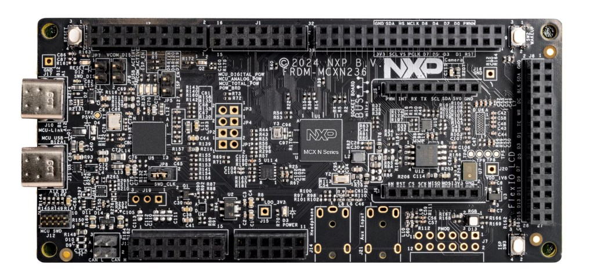
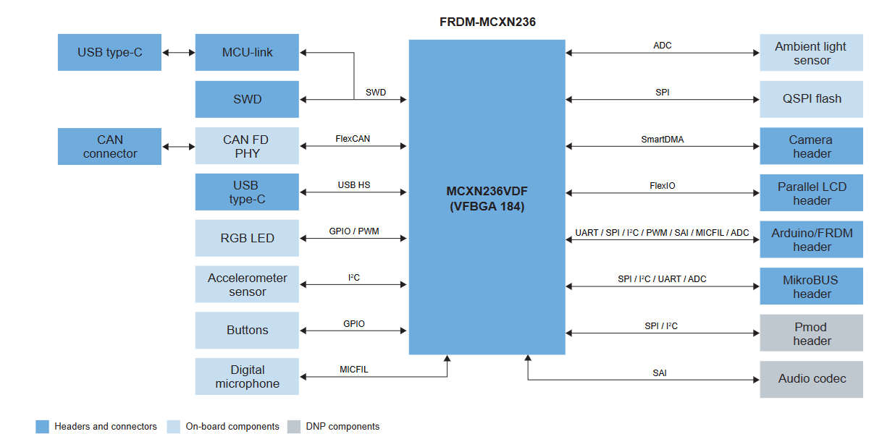

# Zephyr RTOS Course — NXP FRDM-MCXN236

Hands-on workspace from the **Zephyr RTOS Course by [iomico](https://github.com/iomico-public/zephyr-course)**.
It is based on **Zephyr v4.3.0** and contains the application, custom boards, a custom
driver, shell commands and unit tests built along lectures 1–9, all running on the
**NXP FRDM-MCXN236** development board.

<p align="center">
  
</p>

---

## Contents

- [Repository layout](#repository-layout)
- [Course lectures](#course-lectures)
- [Target board: NXP FRDM-MCXN236](#target-board-nxp-frdm-mcxn236)
- [Environment setup](#environment-setup)
- [Build, flash and run](#build-flash-and-run)
- [Running the unit tests](#running-the-unit-tests)

---

## Repository layout

```text
zephyr-course-workspace/          <- west workspace (created by "west init -l")
├── .west/config
├── deps/                         <- Zephyr + HALs fetched by "west update"
│   ├── zephyr/
│   └── modules/ (cmsis_6, hal_nxp, hal_stm32)
└── zephyr-course/                <- this repository (manifest repo)
    ├── west.yml                  <- pins Zephyr v4.3.0 and allowlisted modules
    ├── app/                      <- the course application
    │   ├── src/main.cpp
    │   ├── prj.conf / Kconfig     <- Kconfig options (Lecture 03)
    │   ├── app.overlay            <- devicetree overlay (Lecture 04)
    │   ├── dts/bindings/          <- binding for "zephyr,our-driver" (Lecture 06)
    │   ├── drivers/our_driver/    <- custom sensor driver + shell cmds (Lectures 06–07)
    │   └── modules/               <- calculator & ring_buf modules (Lecture 08)
    ├── boards/
    │   ├── my_frdm_mcxn236/       <- custom board, "copy & rename" (Lecture 05)
    │   └── my_frdm_board/         <- custom board, "from scratch" (Lecture 05)
    ├── tests/                    <- Ztest suites run with Twister (Lecture 08)
    └── docs/                     <- lecture slides and board documentation
```

---

## Course lectures

The slides for each lecture are in [docs/](docs/).

| # | Lecture | Summary |
|---|---------|---------|
| 01 | [Welcome to Zephyr RTOS](docs/Lecture%2001%20-%20Welcome%20to%20Zephyr%20RTOS.pdf) | What Zephyr is (Linux Foundation, multi-architecture, Kconfig + Devicetree), its history, a comparison with FreeRTOS and what is inside it (drivers, networking, subsystems). Ends with the environment setup and the first *Hello World* build. |
| 02 | [West, Topologies & Hello World](docs/Lecture%2002%20-%20West_%20Topologies%20_%20Hello%20World.pdf) | `west` as Zephyr's meta-tool (`init`, `update`, `build`, `flash`, `debug`), the freestanding / repository / workspace topologies and the `west.yml` manifest. Creates this workspace from scratch and builds an LED blink app. |
| 03 | [App Configuration: Kconfig](docs/Lecture%2003%20-%20App%20Configuration_%20Kconfig.pdf) | Kconfig (software features) vs. Devicetree (hardware description). Defining custom symbols, `prj.conf`, `menuconfig`, and organizing options with `menu`, `choice` and `depends on` — see [app/Kconfig](app/Kconfig). |
| 04 | [App Configuration: Devicetree](docs/Lecture%2004%20-%20App%20Configuration_%20Devicetree.pdf) | Devicetree syntax (nodes, labels, properties, phandles), aliases and `chosen`, overlay files and the `DT_*` macros used to access hardware from C — see [app/app.overlay](app/app.overlay). |
| 05 | [Custom Boards](docs/Lecture%2005%20-%20Custom%20Boards.pdf) | What a board is in Zephyr, naming (`board@rev/soc/cluster/variant`) and the required files (`board.yml`, `.dts`, `Kconfig.*`, `board.cmake`). Two boards were created: [my_frdm_mcxn236](boards/my_frdm_mcxn236/) (copy & rename) and [my_frdm_board](boards/my_frdm_board/) (from scratch). |
| 06 | [Zephyr Driver Development](docs/Lecture%2006%20-%20Zephyr%20Driver%20Development.pdf) | Zephyr's device driver model: DTS binding + `compatible`, Kconfig and CMake integration, implementing the Sensor API and instantiating devices from the devicetree. Implemented in [app/drivers/our_driver](app/drivers/our_driver/) (a "sensor" backed by the board LEDs). |
| 07 | [Shell Subsystem](docs/Lecture%2007%20-%20Shell%20Subsystem.pdf) | The interactive shell: backends (UART, RTT, Telnet, USB CDC ACM), static/dynamic commands, built-in commands and logging integration. Adds the `sensor fetch / info / read / set` commands in [our_driver_shell.c](app/drivers/our_driver/our_driver_shell.c). |
| 08 | [Unit Testing](docs/Lecture%2008%20-%20Unit%20Testing.pdf) | Unit testing with **Ztest** (suites, hooks, `zassert_*` / `zexpect_*` / `zassume_*`), running tests with **Twister**, the `twister-out/` results and code coverage with gcovr — see [tests/](tests/). |
| 09 | [Security with Zephyr](docs/Live%20Lecture%2009%20-%20Security%20with%20Zephyr.pdf) | Why security is now mandatory (EU RED / CRA), what Zephyr provides (PSA Crypto, TF-M, MCUboot) and how a secure boot chain works. Live demo on QEMU booting valid, tampered and wrong-key signed images. |

Other material: [Assignment Workflow Submission Guide](docs/Assignment%20Workflow%20Submission%20Guide.pdf),
[Live meeting 02](docs/Live_meeting_02.pdf) and [Live meeting 03](docs/Live_meeting_03.pdf).

---

## Target board: NXP FRDM-MCXN236

The [FRDM-MCXN236](https://www.nxp.com/design/design-center/development-boards-and-designs/FRDM-MCXN236)
is a low-cost NXP development board built around the **MCX N236** MCU (Arm Cortex-M33).
Highlights used in this course:

- On-board **MCU-Link** debug probe (USB-C, connector *J10 "MCU-Link"*) providing
  SWD flashing/debugging and a **virtual COM port** for the Zephyr console/shell.
- **RGB LED** (red / green / blue), used by the Kconfig/Devicetree exercises and by `our_driver`.
- User buttons (`SW2` wakeup, `SW3` ISP), Arduino / mikroBUS / Pmod headers, CAN, audio.
- Zephyr board name: **`frdm_mcxn236`** ([upstream docs](https://docs.zephyrproject.org/latest/boards/nxp/frdm_mcxn236/doc/index.html)).

Board documentation is kept in [docs/NXP_FRDM_MCXN236/](docs/NXP_FRDM_MCXN236/):
[board fact sheet](docs/NXP_FRDM_MCXN236/FRDM-MCXN236.pdf),
[Quick Start Guide](docs/NXP_FRDM_MCXN236/MCXN236QSG.pdf),
[board schematic](docs/NXP_FRDM_MCXN236/SPF-90828.pdf) and the block diagram below.

<details>
<summary>Block diagram</summary>



</details>

---

## Environment setup

The steps follow the official
[Zephyr Getting Started Guide](https://docs.zephyrproject.org/latest/develop/getting_started/index.html)
(select your OS there for the full details). The commands below are for **Windows
(PowerShell)**, which is what this workspace was developed on; on Linux/macOS use the
equivalent commands from the guide.

### 1. Install the host dependencies

Install CMake, Python 3, Ninja, gperf, DTC, Git and 7-Zip. On Windows with `winget`:

```powershell
winget install Kitware.CMake Ninja-build.Ninja oss-winget.gperf python Git.Git oss-winget.dtc wget 7zip.7zip
```

### 2. Create the workspace and a Python virtual environment

```powershell
mkdir C:\Zephyr\zephyr-course-workspace
cd C:\Zephyr\zephyr-course-workspace
python -m venv .venv
.venv\Scripts\Activate.ps1
pip install west
```

> Activate the virtual environment (`.venv\Scripts\Activate.ps1`) in every new terminal.

### 3. Clone this repository and fetch Zephyr

The repository is the **west manifest** (`west.yml`), so the workspace is initialized from it:

```powershell
git clone <this-repo-url> zephyr-course
west init -l zephyr-course     # use zephyr-course/west.yml as the manifest
west update                    # fetch Zephyr v4.3.0 + cmsis_6, hal_nxp, hal_stm32 into deps/
west zephyr-export             # register the Zephyr CMake package
west packages pip --install    # install Zephyr's Python requirements
```

### 4. Install the Zephyr SDK (toolchains)

```powershell
cd deps\zephyr
west sdk install
cd ..\..
```

Or download it manually from the
[Zephyr SDK releases](https://github.com/zephyrproject-rtos/sdk-ng/releases) (this
workspace used `zephyr-sdk-0.17.4`, installed in `%USERPROFILE%`) and run its `setup.cmd`.

### 5. Install the flashing tool

The board is flashed through the on-board MCU-Link probe using **NXP LinkServer**
(the default runner for `frdm_mcxn236`). Download and install it from
[nxp.com/linkserver](https://www.nxp.com/linkserver) and make sure `LinkServer` is on your `PATH`.
J-Link and pyOCD are also supported (`west flash -r jlink` / `west flash -r pyocd`).

> Tip: if the MCU-Link firmware is outdated, update it with the MCU-Link firmware
> update utility installed together with LinkServer.

---

## Build, flash and run

All commands are run from the workspace root (`C:\Zephyr\zephyr-course-workspace`) with
the virtual environment activated.

### 1. Connect the board

Connect a USB-C cable to the **MCU-Link** connector (J10). A new serial port
(`MCU-Link VCom Port`) appears in the Device Manager.

### 2. Build the application

```powershell
# Upstream board definition
west build -p always -b frdm_mcxn236 zephyr-course/app

# ...or one of the custom boards from Lecture 05
west build -p always -b my_frdm_mcxn236 zephyr-course/app
west build -p always -b my_frdm_board   zephyr-course/app
```

The custom boards are found automatically because [app/CMakeLists.txt](app/CMakeLists.txt)
adds `zephyr-course/` to `BOARD_ROOT`.

To browse/change Kconfig options (Lecture 03) interactively:

```powershell
west build -t menuconfig
```

### 3. Flash

```powershell
west flash
```

### 4. Open the serial console and use the shell

Open the MCU-Link VCOM port with any serial terminal (PuTTY, Tera Term, VS Code Serial
Monitor, or `python -m serial.tools.miniterm COMx 115200`) using **115200 8N1**, then
press the board's **RESET** button. You should see:

```text
*** Booting Zephyr OS build v4.3.0 ***
Our driver is ready! Use Sensor Shell command
uart:~$
```

The custom driver can be exercised from the shell (Lecture 07):

```text
uart:~$ sensor info          # device name and ready state
uart:~$ sensor fetch         # calls sensor_sample_fetch()
uart:~$ sensor read          # calls sensor_channel_get() and prints the value
uart:~$ sensor set 50        # sets the LED "intensity"
```

Press `Tab` to list the available commands.

### 5. Debug (optional)

```powershell
west debug
```

---

## Running the unit tests

The tests use Ztest and are run with Twister. `native_sim` is not supported on Windows,
so use `qemu_x86` there (or `native_sim` on Linux/WSL). Run from `zephyr-course/`:

```powershell
cd zephyr-course

# Ring buffer tests (homework, Lecture 08)
west twister -T tests/ring_buf -p qemu_x86 -v

# Calculator tests (Linux/WSL only: native_sim)
west twister -T tests/calculator -p native_sim -v
```

Code coverage for the ring buffer module (Windows), with the SDK's `gcov` on the `PATH`:

```powershell
$env:ZEPHYR_SDK_INSTALL_DIR = "$env:USERPROFILE\zephyr-sdk-0.17.4"
$env:Path = "$env:ZEPHYR_SDK_INSTALL_DIR\x86_64-zephyr-elf\bin;$env:Path"

west twister -T tests/ring_buf -p qemu_x86 --coverage --coverage-tool gcovr `
  --coverage-basedir app/modules/ring_buf --gcov-tool x86_64-zephyr-elf-gcov.exe
```

The HTML report is written to `twister-out/coverage/index.html`.
See [tests/ring_buf/HOMEWORK.md](tests/ring_buf/HOMEWORK.md) and
[tests/calculator/README.md](tests/calculator/README.md) for details.

---

## References

- [Zephyr documentation](https://docs.zephyrproject.org/latest/) ·
  [Getting Started Guide](https://docs.zephyrproject.org/latest/develop/getting_started/index.html) ·
  [West](https://docs.zephyrproject.org/latest/develop/west/index.html)
- [FRDM-MCXN236 in Zephyr](https://docs.zephyrproject.org/latest/boards/nxp/frdm_mcxn236/doc/index.html)
- [Course upstream repository (iomico)](https://github.com/iomico-public/zephyr-course)
